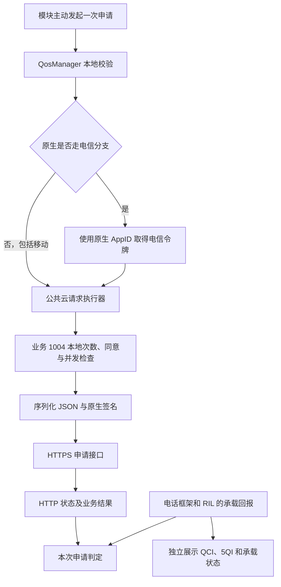

# 荣耀优速通项目详细交接文档

> 版本说明：本文保留 1.1.0 的历史交接基线。后续 1.2.0 已改为系统原生自动场景与局部条件 Hook，当前行为请先阅读 [原生自动流程说明](native-auto.md) 和仓库 README。

> 本文整理用户的问题、已做工作、实机证据、反编译结论、模块实现、交付物及后续验证步骤。接手者可据此继续分析，无需依赖聊天上下文。
>
> **交接代码基线：1.1.0，提交 `60641490cd7a56e2e610c745a8a5ba0a52a16d65`。**
>
> 仓库：https://github.com/haiyan1301/Honor
>
> 已有手机日志来自 2026-11-08。文中的手机时间按当时本机时区理解，用户侧时区为 Asia/Shanghai。历史状态不能直接当作交接时手机的当前状态。

## 1. 接手先看：目前究竟完成到哪里

已经完成：

1. 反编译荣耀设置和系统服务中的 Booster，找到隐藏的荣耀优速通页面、原生触发链、请求流程、计数和冷却逻辑。
2. 确认原生页面能够打开，并通过实机日志确认设置页面确实调用到了后端。
3. 制作并交付两个版本的 LSPosed 模块“优速通观察台”，提供真实原生申请、单次本地 QoS 检查绕过及证据展示。
4. 从用户提供的 1.0.0 实机诊断确认：本地冷却被绕过、电信取令牌成功、随后荣耀云端返回业务码 `202`。
5. 核对申请对象、JSON 序列化、请求头、签名和公共 HTTP 发送层；发现并补充了第二层“公共接口每日调用次数”。
6. 1.1.0 新增电话进程的独立 RIL 只读查询，以及更全面的请求、返回、计数和历史诊断。
7. 完成编译、签名、测试、接口静态核对、仓库上传及远端下载文件一致性验证。

**尚未完成或尚未证明：**

- 没有取得这台手机“云端业务码 200 + 本次新激活专用承载”的完整成功证据。
- 没有证明实际吞吐、时延或网络优先级获得改善。
- 没有取得 1.1.0 的新实机诊断，因此不能保证新增电话进程读取路径已经在这台荣耀手机上工作。
- 截至已收到的资料，尚无这台手机普通数据承载真实 QCI/5QI 的确认样本。
- 没有服务端实现，无法确定 202 对应的具体设备、号码、产品权益或策略，也无法证明服务端是否关联 CHR 统计。
- 中国移动已实现原生分支选择并做代码测试，尚无移动实机申请结果。

项目成果是“可安装模块、可审查源码、请求与证据链、已证实的失败定位”。当前没有把“实际加速已开通”列为成果。

## 2. 用户的原始问题与需求演进

| 用户问题或要求 | 已做工作 | 当前状态 |
| --- | --- | --- |
| 设置 APK 中是否有荣耀优速通隐藏页面，能否增加入口/开关 | 找到 Activity、Fragment、Provider 和移动网络设置页插入位置；模块添加入口并可打开原生页面 | 原生页面可打开已由用户确认；模块新增设置入口有实现和静态核对，未收到单独的入口实机确认 |
| 打开页面或点击立即加速，是否真的生效 | 追踪本地触发、运营商鉴权、荣耀申请、承载回报和界面失败兜底 | 证实页面显示不能单独证明成功 |
| 实际加速在系统侧如何处理 | 分析 QosManager、QosTimer、云请求执行器及专用承载回报链 | 已有完整客户端调用链 |
| 能否用 root / LSPosed 绕过限制并直接申请 | 制作模块，按次调用原生服务并绕过 QoS 冷却/场景次数 | 冷却绕过已获 1.0.0 实机证据；次数耗尽时的实机案例尚未提供 |
| 是否还存在基础额度、次数、冷却限制 | 区分共享 Base、场景 Manual、失败池 Fail、公共接口业务 1004 的每日次数 | 已核实多层本地限制；不能据此推断收费或购买机制 |
| 如何判断真正成功或失败 | 将本地校验、HTTP、原始业务码、电话承载回报分别展示 | 已实现，原始云端拒绝已在 1.0.0 诊断中体现 |
| 是否能显示真实 QCI | 分析荣耀 105/2001 专用承载回报；1.1.0 再增加普通数据连接默认 QoS 与 QoS 会话读取 | 荣耀回报链已反编译确认；实际数值和新增读取路径仍需实机证据 |
| 是否也考虑中国移动 | 按当前上网卡 PLMN 选择原生分支，保留电信特有鉴权 | 已实现；移动未实机验证 |
| 本地次数是否会带到云端，并导致拒绝 | 核对请求 JSON、头、签名、公共发送层和独立 CHR 统计路径 | 申请中未见直接携带这些本地次数；统计是否被服务端使用仍未知 |
| 日志要全面，不能简单绕过后显示成功 | 增加实际 HTTP 参数、前后记账、公共计数、网络/卡槽、原始返回、历史快照和独立本机 QoS | 1.1.0 已交付，新增观察点待实机验证 |
| 整理详细交接文档 | 本文及已有请求审计说明、源码、构建验证记录 | 文档交付 |

## 3. 已知手机及软件环境

| 项目 | 已知信息 |
| --- | --- |
| 手机 | 用户称荣耀 Magic7 Pro；诊断中的 Build.MODEL 为 PTP-AN70 |
| 系统 | Android 16，SDK 36，MagicOS 10 |
| 系统完整编译版本 | 未提供完整字符串 |
| root | KernelSU；精确版本未提供 |
| LSPosed | 用户称最新版；精确构建号未提供 |
| 已提供实机结果的运营商 | 中国电信 |
| 后续要求兼顾的运营商 | 中国移动 |
| 设置包 | `com.android.settings`，14.0.0.210 |
| 系统服务包 | `com.hihonor.systemserver`，70.1.0.1 |
| 当前 Android 用户 | 用户此前查询为 0 |
| 系统服务安装位置 | `/system/priv-app/HnSystemServer` |
| 包管理器报告的数据目录 | `/data/user_de/0/com.hihonor.systemserver` |

用户曾实机读取：

```text
ro.vendor.radio.qos_feature_enable = true
msc.foreground_data_opt_enable = true
settings global NetworkQosGamePeriod = 2
```

这些值说明相关本地条件满足或功能开启，不能单独证明云端允许服务或承载已经激活。

### 3.1 KernelSU 文件视图问题

终端 root 下，常规 `/data/user_de/0/...` 路径曾显示不存在，而包管理器仍报告该 dataDir。使用 `/proc/1/root` 前缀后成功读取同一份数据。

已成功使用的路径：

```text
/proc/1/root/data/user_de/0/com.hihonor.systemserver/shared_prefs/BoosterQos.xml
```

这说明当时存在挂载命名空间/文件系统视图差异。后续遇到同类现象应先检查视图，而不是反复猜测另一个包名、用户或 CE 数据目录。

## 4. 输入资料与证据清单

| 资料 | 用途 | 主要结论 |
| --- | --- | --- |
| 设置_14.0.0.210.apks | 设置入口、页面、调用方式 | 隐藏 Activity、Fragment、Provider 写入方式 |
| 设置_14.0.0.210.7z.001～004 | 分卷形式的安装包资料 | 提取设置 APK；不是四个不同版本 |
| 系统服务_70.1.0.1.apks | 系统服务主包及 Booster 等拆分 | 原生请求、冷却、计数、云端和承载链路 |
| ForegroundDataOpt.xml | 场景配置 | 手动场景 21、QCI 6、建议 30 分钟及条件位图 |
| qos_timer.xml | QoS 配额与冷却配置 | Base/Manual/Fail、202 冷却、按 QCI 的电信 AppID 配置 |
| fastpass-check.txt | 最初的过滤日志 | 只有普通场景触发，覆盖不足，不能确定立即加速结果 |
| fastpass-detail.txt | 更完整的原生页面实机日志 | 请求在本地保存的 202 冷却处被拒绝；失败分支仍可更新正在加速的显示 |
| 用户终端输出 | 属性、当前用户、包路径、共享首选项 | 确认 KernelSU、文件视图问题和历史冷却记录 |
| fastpass-diagnostic-20261108-175729.txt | 模块 1.0.0 实机导出 | 三次本地放行、电信取令牌成功、云端业务码 202，未获得承载回报 |

原始 OEM APK、用户完整诊断和私有签名材料未放进公开源码仓库。新接手环境如果没有这些文件，应向原持有人取得匹配版本的资料；仓库中的模块源码不包含完整 OEM 反编译工程。

### 4.1 已分析 APK 的 SHA-256

```text
Settings.apk
623e931d451904f9dc5732dfa2b726158d954eb06bc698651ae744535913757c

HnSystemServer.apk
65860404ae57323ded926b166e1b776c7ae2e4bd376112a097c2ebf1b64a8472

Booster.apk
c60fbf4060dbd14f20c2232e85764f6305c484c7e7b79b683ea2ad477142e8e6
```

## 5. 调查过程及结论更新

| 阶段 | 做了什么 | 当时能够确定什么 |
| --- | --- | --- |
| 设置分析 | 解包、反编译设置，找到隐藏页面与后端写入 | 页面存在，入口可以恢复 |
| 系统服务分析 | 提取 Booster，跟踪场景、QosManager 和承载处理 | 实际申请交给系统服务和云端，界面不是最终判据 |
| 配置核对 | 查看用户提供的两个 XML 和属性 | 手动场景参数、共享额度及冷却配置存在 |
| 原生实机日志定位 | 从宽覆盖日志追踪页面点击到 QosManager | 当时 `uo=202` 是本地冷却拒绝，尚未发起新云请求 |
| root 数据读取 | 排查 CE/DE 路径和 KernelSU 视图，读到 BoosterQos.xml | 找到历史 202 冷却起点及 10080 分钟配置 |
| 模块 1.0.0 | 单次本地绕过、直接原生申请、云端和专用承载观察 | 用户实机日志证明本地冷却绕过、电信取令牌及新云端 202 |
| 请求深度核对 | 追踪最终 JSON、头、签名和公共执行器 | 发现第二层本地次数及独立 CHR 统计；没有发现次数作为申请的直接参数 |
| 模块 1.1.0 | 独立 RIL QoS 读取、更完整的请求/返回/计数日志 | 已编译、测试、签名和交付，等待新增实机诊断 |

**早期本地 202 和后来云端 202 的来源不同。** 两个结论反映了不同阶段的证据，不能只看相同的数字就混为一谈。

## 6. 隐藏页面及原生开关

### 6.1 页面信息

```text
Activity:
com.android.settings.Settings$DedicatedDataActivity

Fragment:
com.hihonor.smartnetwork.DedicatedDataActivitySettings

Intent action:
android.settings.EXPRESS_APP_SETTINGS
```

可用以下方式打开，用户已经确认页面能打开：

```sh
su -c 'am start -a android.settings.EXPRESS_APP_SETTINGS -p com.android.settings'
```

模块另在 `com.android.settings.WirelessSettings.onCreate(Bundle)` 后，使用原应用的 `ArrowPreference` 添加“荣耀优速通 · 观察台”入口。

### 6.2 页面到后端

Provider authority：

```text
com.hihonor.systemserver.booster.smartnetselprovider
```

Provider 为签名权限保护的系统接口。普通 shell 的 content 查询被拒绝，不代表 Provider 不存在。

原生主要操作：

- 总开关写入 `total_switch=1/0`。
- “立即加速”写入 `acc_now=0` 并更新时间。
- Provider 通知观察者，随后创建手动场景 21。
- 原生手动事件会校验调用方为 `com.android.settings`。

模块的直接申请不冒充设置 Provider 调用方，而是在目标系统服务进程内直接调用原生 QosManager。

### 6.3 已核对的主要本地条件

- QoS 产品开关、原生服务是否已启动。
- 国内版本判定、原生服务期状态、总开关及场景配置。
- 蜂窝数据、WLAN、VPN、漫游和支持的网络制式。
- PLMN、蜂窝 IPv4、必要参数和同类 IP/QCI 重复请求。
- 本地冷却、共享/场景次数、原生任务并发。

配置文件可能被 COTA 下载配置覆盖。上传的默认 XML 是证据之一，运行时实际加载值更有优先级。

## 7. 系统侧实际申请链路

原生页面大致经过：

```text
设置页 → SmartNetSelProvider → 观察事件
→ DataAccelerateManager → 手动场景 21
→ DataAccelerateScene.startQosReq
→ CommsCloudProxy / DedicatedBearerCould / IntelligentManager
→ QosManager.requestDedicatedBearer
```

模块从 QosManager 开始直接调用，后面的主要链路如下：



主要类/方法，以下省略共同前缀 `com.hihonor.systemserver.booster`：

```text
ollie.intelligent.qos.QosManager.requestDedicatedBearer
ollie.intelligent.qos.QosManager.checkIfQosReqLegal
ollie.intelligent.qos.QosManager.handleTelecomReturn
ollie.intelligent.qos.QosManager.doCloudTask
framework.intf.CloudReqTaskExecutor.executeTask
framework.cloudinter.CloudReqTask.doInBackground
framework.cloudinter.common.RequestBody.toJson
framework.cloudinter.common.sign.SignatureHelper.getSignature
framework.cloudinter.common.HttpRequest.request
ollie.intelligent.qos.QosManager.doWhenQosSuccess
```

申请路径为 `/dedicatedbearer/v1/apply`。域名由原生 GRS 配置解析，不能把内置备用域名当作手机每次实际使用的域名。

### 7.1 移动与电信

原生 QosManager 的电信分支 PLMN：`46003 / 46005 / 46011 / 46012`。

- 电信先根据请求 QCI 从原生 TokenAppid 配置取 AppID，调用电信令牌接口，再将令牌填入荣耀申请。
- 原生非电信分支直接进入荣耀申请；模块对移动沿用这条分支。
- 模块固定关联请求时的数据卡槽，不把其它 SIM 的承载回报认作本次结果。
- 双卡切换后应刷新。1.1.0 记录发送时默认网络和数据卡槽，辅助识别申请过程中切卡的情况。

已证明电信能够走到取令牌和云端业务拒绝；没有证明电信获批，也没有移动实机结果。PLMN 名称识别不等于运营商承诺支持。

## 8. 申请到底携带什么

### 8.1 JSON 请求体

`QosRequest` 的实例字段为 `requestInfo`，其中是 `DBRequestInfo`。普通 Gson 完成序列化，结构为：

```json
{
  "requestInfo": {
    "plmn": "运营商 PLMN",
    "rat": "原生制式编码",
    "qciType": 6,
    "scene": "Manual",
    "qosCause": "Scene",
    "ip": "蜂窝 IPv4",
    "ipv6": "蜂窝 IPv6",
    "destinationIpList": "目的 IP 串，QCI 6 允许为空",
    "duration": 30,
    "token": "原生流程填入的令牌",
    "applyId": "原生生成的申请 UUID"
  }
}
```

上面是字段结构说明，不是某次实际发包原文；字符串说明也不是实际请求值。实际原生字段类型、值和发送层证据以 1.1.0 的诊断为准。

| 字段 | 说明 |
| --- | --- |
| plmn | 请求时当前上网卡的 PLMN |
| rat | 原生网络制式编码 |
| qciType | 希望申请的 QCI，不能当成实际读取值 |
| scene | Manual 是申请场景名称 |
| qosCause | Scene 是触发原因 |
| ip、ipv6 | 蜂窝地址，诊断中脱敏 |
| destinationIpList | 目的地址串；QCI 6 允许为空 |
| duration | 建议时长，模块为 30 分钟；不代表服务端已经授予 |
| token | 电信令牌由原生流程处理；按运营商分支决定 |
| applyId | 当前申请 UUID，用于模块关联本次证据 |

`scene="Manual"` 是字符串参数，不是 `Manual` 剩余次数。

### 8.2 请求头

已核对 `QosRequest.generateHeaders()`：

```text
Content-Type
Charset
Accept-Encoding
X-Req-Src
X-App-Version
X-CP-AppId
X-Request-ID
Batch-ID
Product-Name
VendorCountry
Is-Beta
OsVersion
Is-Test
Device-Id
```

公共 HTTP 层另写入 `authorization` 签名。

两个容易误判的字段：

- `Device-Id` 在已分析代码中是首次生成后持久化的 UUID，不应直接称为 IMEI。
- `Batch-ID` 是首次随机取 0–99 后持久化的批次值，不是“已申请次数”。

### 8.3 签名及真正发送

`SignatureHelper` 以 HTTP 方法、URL 路径、规范化 query、完整 JSON、cp appId 和当前时间戳生成 HMAC 认证头。核对路径中未读取 QosTimer 或通用调用次数缓存。

`HttpRequest` 将上述头写到 HTTPS 连接，将签名写入 authorization，然后发送同一个 JSON 字节串。没有发现向此申请追加 Base/Manual/Fail 或冷却字段的操作。

模块不更改令牌、设备 UUID、签名或请求场景来伪造云端权益。

## 9. 本地次数、云端计数和统计要分开理解

### 9.1 第一层：QoS 场景与冷却

`QosManager.checkIfQosReqLegal()` 依次检查服务、参数、冷却、场景次数、并发和已有 IP。

用户上传配置中的典型值：

| 名称 | 配置初始值 | 含义 |
| --- | --- | --- |
| Base | 18 | 多场景共享的基础次数 |
| Manual | 4 | 手动场景自己的次数 |
| Fail | 100 | 原生失败记账时优先消耗的失败池 |

实际剩余值存于运行时内存/BoosterQos 首选项，不能只看 XML 初始值。

入口的场景次数判断是 `Base > 0 或对应 scene > 0`。`Fail` 主要参与完成后的失败记账，不是这里的独立放行条件。

`QosTimer.addQosReqSceneTime()` 的关键行为：

1. 失败且 Fail 仍大于 0，优先减 Fail。
2. 否则可能减 Base。
3. Base 没有剩余时，再按场景减对应次数。

因此，失败池耗尽后，失败也可能继续消耗 Base/场景次数。Manual=4 不能解释为无条件“每天总共只能申请四次”，也不能据 Base+Manual 推导云端一定能获批多少次。

模块只对自己发起的这次同步校验绕过 QoS 冷却和场景次数。原生完成记账和新冷却仍会执行，不会自动回滚。

### 9.2 第二层：公共接口每日次数

`CloudReqTaskExecutor` 的业务号 `1004` 另有一次本地检查：

- 从 `cloud_interaction_config.xml` 读取 `dailyMaxInteractTimes`。
- 从 `INTER_TIMES_CACHE_MAP` 读取“`1004_日期`”计数。
- 在上限内时，先加一，再进入后续申请。
- 配置缺失或达到上限时，在 HTTP 前返回本地执行器错误。
- 同时还有协议同意及同业务并发检查。

1.1.0 保留并记录这一层。它没有被第一层 QoS 绕过连带跳过。

公共执行器代码与 QoS/HTTP 代码必须结合字段来源解读：

| 公共执行器代码 | 含义 |
| --- | --- |
| 1004 | 正常业务号，继续流程 |
| 101 | 本地每日调用检查未通过，或相关配置缺失 |
| 102 | 原生协议同意检查未通过 |
| 103 | 同业务已有请求 |

例如执行器的 101，不等于 QosManager 的“产品不支持”101；执行器代码也不是 HTTP 状态码。

### 9.3 第三条路径：CHR 统计

发现的独立路径：

```text
CloudReqTaskExecutor.processExpiredData/reportProtocolFlow
  → 旧日期的业务号、日期、次数流水

QosChr.QosProtocolFlow.reportToDb
  → 请求、结果、部分本地拦截累计和失败流水

两者进入 OllieChrProxy
  → OllieChrManager
  → HnChrReportConnImpl
```

已确认的是独立统计/落库路径。尚未确认这些统计在服务端的消费方式，也没有证据证明它们一定被用于优速通准入。

### 9.4 对用户核心疑问的准确回答

- **可证实：** 已分析客户端没有把上述本地剩余次数作为 `/apply` 的直接业务参数发送。
- **可证实：** 本地次数能影响请求是否会发出；绕过入口不等于阻止后续记账。
- **可证实：** 存在独立的调用/失败统计路径。
- **无法证实：** 云端是否使用这些统计参与准入或频控。
- **不能推导：** 没有直接携带本地次数，就意味着云端不计数、不限频或本地修改能够恢复权益。

未发现本地计数对应购买流程的证据。计数存在本身不能证明收费，也不能证明服务无限制。

## 10. 202 的两个不同来源与实机证据

### 10.1 最初原生页面：本地缓存的 202

`fastpass-detail.txt` 显示：

- 设置的立即加速点击进入后端，Provider 更新返回 1。
- 手动场景 21 被创建。
- QosManager 记录 `product is in punish duration`。
- `requestDedicatedBearer` 的本地校验返回 `uo=202`。
- 本次没有进入只有校验值 -1 才执行的新鉴权/云申请分支。

因此，该录制里的 202 只能证明本地保存的冷却拒绝，不能当作当时新收到的云端回复。

用户随后读取到历史记录：

```text
punish_error = 202
punish_error_happen_time = 20261108091832
punish_error_duration = 10080
```

对于不少于一天的这类时长，已核对代码按跨日数量判断到期，而不是精确累计分钟。如果这条记录未被后续请求刷新，按当时手机日期应在 2026-11-15 起的首次检查具备清除条件。清除本地冷却并不代表云端服务恢复；后来的申请也确实又写入了新的起点。

### 10.2 模块 1.0.0：新收到的云端 202

`fastpass-diagnostic-20261108-175729.txt` 中有三次模块申请，均显示：

```text
localCode = -1
电信 HTTP = 200
电信已返回令牌
CloudTaskResult = NO_ERROR
QosResponse.code = 202
nativeResult = 3
```

最后一份状态还显示：

```text
Base 剩余 = 18
Manual 剩余 = 4
Fail 剩余 = 96
没有观测到专用承载回报
没有可用的已缓存承载条目
```

这说明已越过此前的本地冷却及正常公共请求流程，完成电信取令牌，并收到了荣耀业务响应。此时不能再把失败解释为“仍被最初本地 202 挡住”。

这里的“电信 HTTP 200”属于取令牌接口，不是荣耀申请成功。1.0.0 没有单独导出荣耀接口的 HTTP 状态观察字段；该阶段的业务响应证据来自原生 CloudTaskResult 与 QosResponse。1.1.0 才补充荣耀申请接口的独立 HTTP 状态及解析前 JSON 记录。

### 10.3 202 的含义及边界

原生常量：

```text
QOS_OUT_OF_EXPIRY_DATE = 202
```

它属于服务有效期类业务拒绝。此次 `msg/remoteMessage` 为空，无法进一步确认具体对象是设备、号码、产品权益、服务有效期还是其它服务端策略。

此时没有证据显示 Base/Manual 已耗尽，也没有依据把云端 202 直接归因于本地剩余次数。

## 11. 为什么原生页面“正在加速”不能当成成功

已从反编译与原生实机日志确认：

1. 设置页面部分交互采用乐观显示。
2. `onProcessManualQosSwitchFail` 在失败路径中，也可能把 `network_status` 更新为 1。
3. 失败兜底还可能更新显示增益、运行计数或展示一段加速状态。
4. 原生错误映射把网络无响应 `104` 也映射为本地成功结果 `1`。

因此以下信息均不能单独作为真实成功证据：页面文案、总开关开启、network_status=1、次数增长、显示的提速百分比，或本地完成结果 1。

1.0.0 已暴露并区分原始业务返回与本地映射；1.1.0 进一步记录 HTTP 状态及原生反序列化前的 JSON。

## 12. 真实 QCI/5QI 从哪里来

### 12.1 概念边界

- QCI/5QI 是网络为承载/QoS 流配置的参数，手机可以读取基带/框架回报。
- 同一张 SIM 可以有多个数据连接及 QoS 会话，不能用一个固定值概括整张卡。
- LTE 的 QCI 和 NR 的 5QI 分别展示。
- 配置中的 `qciType=6` 是申请目标，不是实际观测值。
- 普通上网数据、IMS 等连接可能同时出现在电话框架数据列表中，不能把每条连接都标成当前上网默认承载。

### 12.2 荣耀原生专用承载链路：已反编译确认

```text
HwTelephonyManagerInner.registerForHnUnsolCommMsgCallback(slot, 105, callback)
→ RadioProxy.handleDedicatedBearIndication
→ HwCommBoosterService / Booster 回调 2001
→ BoosterClient.handleDedicatedBearerInfoInd(Bundle)
→ DedicatedBearerInfoInd protobuf
→ 每个条目的 bearerType / qci / bearerState
→ LinkToTransportCommunication / DataAccelerateScene / BearInfo
```

这条链路读取的是电话框架回报，不是申请参数回显。但它是专用承载通道，不保证包含所有普通默认数据承载。

原生匹配条件：

```text
bearerType == 2 && qci == 请求的 QCI && bearerState == 1
```

`bearerType=1 && qci=6` 是另一种 VIP 分类，不能混用。

已确认到荣耀电话框架注册接口及上层 protobuf 解析；没有取得对应下层供应商 RIL/基带实现，不能宣称已经确定具体 QMI 或 AT 指令。

### 12.3 1.1.0 独立普通承载读取：已实现，待实机

新增 `com.android.phone` 进程内观察器：

```text
PhoneFactory.getPhones()
→ 每个 Phone 的 mCi / CommandsInterface
→ getDataCallList(Message) 主动只读查询
  + registerForDataCallListChanged 被动变化回报
→ DataCallResponse
→ getDefaultQos()
  + getQosBearerSessions()
→ EpsQos.getQci() / NrQos.get5Qi()
```

这些接口已与 Android 16 AOSP 对照。该手机的实际电话框架 APK/JAR 尚未提供，因此供应商是否保留接口、是否填入 QoS 数据，仍需新诊断验证。

空值、缺失接口、无连接、查询错误、无有效正数值时保留未知和原因，不填默认 QCI=9，也不把申请值 6 当作真实值。

当连接接口名能与当前系统默认蜂窝接口匹配时，界面会作标记；未匹配的连接仍按各自 CID/接口展示。

## 13. 模块架构、作用域及源码位置

模块包名：`dev.codex.fastpass`；应用名：优速通观察台。

| 目标 | 作用 |
| --- | --- |
| `com.hihonor.systemserver` | 原生申请、单次 QoS 本地绕过、云端/HTTP/计数/荣耀专用承载观察 |
| `com.android.settings` | 在移动网络设置中增加观察台入口 |
| `com.android.phone` | 1.1.0 新增的独立 RIL 数据连接 QoS 读取 |

这里的荣耀 `com.hihonor.systemserver` 是具体的系统服务应用包，不应误选成 Android 通用的 `system_server` / 系统框架作用域。

主要源码：

| 文件 | 职责 |
| --- | --- |
| [HookEntry.java](../app/src/main/java/dev/codex/fastpass/HookEntry.java) | 目标进程入口、系统服务应用初始化、设置入口、电话进程 attach |
| [NativeBackend.java](../app/src/main/java/dev/codex/fastpass/NativeBackend.java) | 原生调用、ThreadLocal 单次绕过、各阶段观察、计数与请求快照、承载判定 |
| [PhoneBackend.java](../app/src/main/java/dev/codex/fastpass/PhoneBackend.java) | 各卡槽 RIL 只读查询及变化回报、超时处理 |
| [RadioEvidence.java](../app/src/main/java/dev/codex/fastpass/RadioEvidence.java) | 默认 QoS/会话解析、LTE QCI 与 NR 5QI 的区分、未知处理 |
| [WireAudit.java](../app/src/main/java/dev/codex/fastpass/WireAudit.java) | 实际请求关联、脱敏、计数字段名检查、响应大小限制 |
| [OutcomePolicy.java](../app/src/main/java/dev/codex/fastpass/OutcomePolicy.java) | 与 Android 解耦的结果判定 |
| [OperatorRoute.java](../app/src/main/java/dev/codex/fastpass/OperatorRoute.java) | 电信原生分支识别及运营商显示 |
| [BridgeProvider.java](../app/src/main/java/dev/codex/fastpass/BridgeProvider.java) | 受 UID 限制的状态/命令桥、请求历史和事件持久化 |
| [MainActivity.java](../app/src/main/java/dev/codex/fastpass/MainActivity.java) | 面板、查询/申请/导出操作及状态展示 |
| [Protocol.java](../app/src/main/java/dev/codex/fastpass/Protocol.java) | 包名、广播、Provider、模块版本等常量 |

### 13.1 桥接与权限

- 面板通过本机 ContentProvider 排入命令，并用签名权限保护的广播唤醒后端。
- 只有模块自身能排入加速操作命令。
- 系统状态发布由平台 UID 1000/root 使用；电话 UID 1001 仅能写 `radio` 命名空间。
- APK 自身只申请自定义控制权限，不申请 INTERNET 或存储权限；网络与电话读取发生在已注入的原生目标进程。
- 模块不直接执行 su，不改系统 APK，不依赖终端的 root 挂载视图。

### 13.2 单次绕过的范围

通过 ThreadLocal 将改动限定在面板主动发起的该次调用和对应请求对象；保留服务启动、参数、原生并发及重复 IP/QCI 保护。

没有全局改写其它原生请求的校验，没有清空或重写持久化冷却，也没有把服务端返回改成成功。公共云接口的每日次数、同意、并发和签名仍走原生流程。

## 14. 1.0.0 与 1.1.0 的成果差异

| 项目 | 1.0.0 | 1.1.0 |
| --- | --- | --- |
| 隐藏页面/观察台入口 | 有 | 保留 |
| 移动、电信原生分支 | 有 | 保留 |
| 单次 QoS 冷却/场景次数绕过 | 有；冷却绕过有实机证据 | 保留，另外明确记录是否实际应用 |
| 云端结果 | 原生反序列化后的 code/duration/msg/remoteMessage | 再增加实际 HTTP 及反序列化前的 JSON 观察 |
| 专用承载 QCI | 荣耀 105/2001 观察 | 保留并按卡槽独立展示 |
| 普通连接默认 QCI/5QI | 未实现 | 新增电话进程独立只读查询 |
| 公共接口每日次数 | 未完整展示 | 新增业务 1004 的配置、前后计数、执行器结果 |
| 请求前后 QoS 记账 | 全局状态为主 | 按请求记录 quotaBefore/After |
| 请求参数 | 以构造参数为主 | 记录实际原生 HTTP 对象的脱敏 body/headers、网络及时间 |
| 历史 | 以当前请求及事件为主 | 有限长度的最近请求快照及更完整事件导出 |
| duration=0 | 存在被建议 30 分钟覆盖显示的问题 | 如实保留服务端 0 |
| 实机验证 | 用户已提供系统服务、电信取令牌、云端拒绝证据 | 新增电话及 HTTP 审计路径尚无实机结果 |

## 15. 成功判定与状态机

“已确认承载激活”同时要求：

1. 本次真实云端业务码为 200。
2. 本次请求之后，正确卡槽收到新的荣耀专用承载回报。
3. 存在 `type=2 / qci=6 / state=1` 的匹配条目。
4. 有可靠的前态或状态变化证据，能排除简单沿用已存在承载的情况。

可靠前态来自请求前 5 秒内本模块观察到的真实回报，或本次先收到新的无匹配活跃承载回报、随后再收到激活回报。无时间戳的空缓存不算可靠前态。

| 状态 | 含义 |
| --- | --- |
| IDLE / PREPARING / WAITING | 未开始、准备、等待证据 |
| LOCAL_REJECTED | QoS 本地校验未通过 |
| COMMON_LOCAL_REJECTED | 公共接口本地检查拦截；不能称为云端拒绝 |
| TELECOM_FAILED | 电信取令牌失败 |
| HTTP_REJECTED | 实际 HTTP 状态非预期成功 |
| CLOUD_REJECTED | 已取得原始业务响应，业务码不是 200 |
| TRANSPORT_UNCONFIRMED | 原生完成了回调，但缺少已确认的原始云端响应 |
| ACTIVE_PREEXISTING | 承载活跃，但前态已活跃或基线不可靠，归因未确认 |
| CONFIRMED | 满足上述云端及新承载证据条件 |
| BEARER_TIMEOUT | 约 120 秒未取得所需组合证据 |
| ENDED | 本次观察结束 |
| ERROR | 本次处理异常或关键 Hook 命中无法确认 |

其它卡槽、旧回报、类型 1 的 QCI 6、未激活承载、缺失云端响应及原生完成映射 1，都不能单独变成 CONFIRMED。

超时后的回报可以继续作为实时信息显示，但不重新打开已结束的申请。停止观察不等于取消已经发给原生服务/网络的申请。

监测解除前还会检查其它活跃专用承载和原生工作状态，避免直接打断原生已有业务。

这一判定是现有客户端证据标准，不是网络侧逐承载的申请 ID 映射，更不是吞吐/时延改善的独立测量。在同卡同 QCI 有其它触发源时，仍需保留因果归属边界。

## 16. 1.1.0 诊断文件如何阅读

顶层通常包含：

```text
app、device、sdk、exportedAt、timeZone、elapsedRealtime
state
requestHistory
events
```

主要 `state` 字段：

| 字段 | 用途/解读 |
| --- | --- |
| moduleVersion / backendVersion | 注入模块版本及原生包版本；安装新 APK 不等于旧进程已重载 |
| backendReady / wireAuditReady | 观察点安装状态，不单独证明某次 Hook 已命中 |
| sessionId / applyId / requestSlot | 当前模块会话、原生申请及卡槽关联 |
| localCode / qosBypassApplied | 本地 QoS 结果及实际应用绕过的记录 |
| commonLocalCode / commonCloudChecks | 公共本地检查结果、前后值和是否观察到检查 |
| commonCloudBudget | 当前公共业务 1004 配置/计数，不保证等于历史某次请求时的值 |
| preflight | 当次构造前条件、卡槽、PLMN、制式和时间 |
| quotaBefore / quotaAfter | 当次前后 Base/Manual/Fail 及冷却快照 |
| requestAudit.captured | 到达实际原生 HTTP 对象；尚不等价于收到了服务端响应 |
| requestAudit.body / headers | 按 applyId 关联后的脱敏实际字段 |
| requestAudit.counterFieldPaths | 候选计数字段名称；不是对所有编码内容的万能语义证明 |
| requestAudit.network / signatureTimestamp | 发送层默认网络、数据卡槽和原生签名时间 |
| httpStatus / httpResponse | 实际 HTTP 状态、原生解析前 JSON、服务器 Date 等可用证据 |
| cloudReceived / cloudCode / cloudRaw | 原生云端响应及业务结果 |
| returnedMinutes | 服务端实际返回时长，0 保留为 0；未获得时为未知 |
| nativeResult | 原生本地完成映射，仅供参考 |
| vendorSlots | 荣耀专用回报按卡槽的实时信息 |
| sessionBearers / bearerFresh / baselineKnown | 当前申请关联的承载证据及前态可靠性 |
| radioReady / radioError / radioSlots | 新电话读取状态、各卡槽连接及读取失败原因 |
| radioActiveCellularInterface | 可识别时的系统默认蜂窝接口名 |
| verdict | 按证据规则得到的结果 |

### 16.1 日志范围与保留上限

- 最多保存最近 6 次请求快照，另有约 120000 字符总长度限制。
- 最多 300 条事件，另有约 180000 字符总长度限制。
- 原生响应 JSON 观察输入有 64 KiB 上限；脱敏后超过 24000 字符时明确缩减为主要业务字段。
- HTTP 非 200 时，尝试读取原生原本未使用的错误流，最多 32 KiB。
- 电话读取最多 4 个端点，每个展示前 16 条数据连接、每连接前 8 个 QoS 会话；超出时记录总数/提示。
- 查询至少间隔约 3 秒，主动查询约 12 秒未回调会显示超时。
- UI 自动刷新及只读查询不是自动循环发送加速申请。

这些约束用于控制 Binder 事务和诊断体积。日志经过脱敏及限长，不能称为完整 TLS 抓包。未知字符串、令牌、签名、设备标识和地址可能被遮蔽；缺少字段有时意味着观察未命中或供应商没有提供，不能直接当作数值为零。

## 17. 已交付文件与校验

### 17.1 版本及代码基线

| 版本 | versionCode | 代码/交付提交 |
| --- | --- | --- |
| 1.0.0 | 1 | `6170e8982e963a5cf6b37a179fb735fffa8cb0df` |
| 1.1.0 | 2 | `60641490cd7a56e2e610c745a8a5ba0a52a16d65` |

本交接文档作为后续文档提交保存，不改变上述 APK、源码归档或其校验值。

### 17.2 下载

- [APK 1.1.0](https://github.com/haiyan1301/Honor/raw/refs/heads/main/downloads/HonorFastPassObserver-1.1.0.apk)
- [源码归档 1.1.0](https://github.com/haiyan1301/Honor/raw/refs/heads/main/downloads/HonorFastPassObserver-1.1.0-source.zip)
- [APK 1.0.0](https://github.com/haiyan1301/Honor/raw/refs/heads/main/downloads/HonorFastPassObserver-1.0.0.apk)
- [源码归档 1.0.0](https://github.com/haiyan1301/Honor/raw/refs/heads/main/downloads/HonorFastPassObserver-1.0.0-source.zip)
- [校验清单](../downloads/SHA256SUMS.txt)
- [1.1.0 验证记录](../downloads/verification-1.1.0.json)
- [76 项原生接口核对报告](../downloads/native-contract-1.1.0.json)
- [专题：请求参数、计数与 QCI 反编译核对](request-audit.md)

1.1.0 APK 为 57885 字节，源码归档为 55819 字节。

```text
HonorFastPassObserver-1.1.0.apk
dec4315037b1320e15337c609fd0416ef1af5a30e8fac57ba17587238468c728

HonorFastPassObserver-1.1.0-source.zip
054a5673b9b6efc2496c94252fdce7ac7287b10451d59119c3a738b9a3a7884b

HonorFastPassObserver-1.0.0.apk
20c3fafaf42ba3a121b2a61345db228fc4756852fe3d364a020fb91e86c6ccb3

HonorFastPassObserver-1.0.0-source.zip
a3928aad782a242394060228ae1c6cb4514d566c07aac0775adf6b049cd3f683
```

1.1.0 与 1.0.0 使用同一签名证书，支持覆盖升级；私钥未公开。

最初会话的文件导出目录不可写，用户提供上述 GitHub 仓库后，改用该仓库交付。APK 和源码包均实际从远端重新下载并核对了大小与 SHA-256。

## 18. 已做哪些验证，哪些验证没有做

| 验证项 | 结果及边界 |
| --- | --- |
| 1.1.0 编译 | 通过 |
| 结果判定测试 | 38 项通过，覆盖本地/公共/HTTP/业务拒绝、旧承载、卡槽、超时及分支等 |
| 参数与无线证据测试 | 31 项通过，覆盖脱敏、请求关联、计数字段发现、大小上限、LTE/NR、默认与会话、缺失值等 |
| 原生 DEX 接口核对 | 76 项通过，检查目标方法/字段存在及签名 |
| Android 16 AOSP 电话接口对照 | 完成；不等于验证荣耀供应商实现 |
| APK 签名 | v3 验证通过，与旧版证书一致 |
| APK 打包检查 | 包名、版本、SDK、权限、Xposed 入口等已核对；未把 Xposed API 或测试 JSON JAR 打入 APK |
| 交付检查 | 远端分支、文件、二进制 blob、实际下载哈希核对通过 |
| 1.0.0 系统服务实机链路 | 用户诊断确认注入、本地冷却绕过、电信取令牌及云端 202 |
| 1.1.0 新电话/HTTP 观察点实机 | 尚无新诊断 |
| 真正获批及专用承载激活 | 尚未证明 |
| 性能提升 | 未进行可对照的吞吐/时延测量 |

69 项测试 = 38 项判定 + 31 项参数/无线证据测试。76 项接口核对是静态检查，应与测试数量分开描述。任何一组通过都不能替代手机和运营商的真实执行结果。

## 19. 安装、升级及最小复测步骤

1. 覆盖安装 1.1.0，并打开一次“优速通观察台”。
2. LSPosed 启用模块，按包名勾选：`com.hihonor.systemserver`、`com.android.settings`、`com.android.phone`。
3. 重启手机，使目标进程加载新模块。仅安装新 APK 不会自动替换已经注入的旧进程代码。
4. 打开观察台，确认后端模块版本为 1.1.0、原生后端版本为 70.1.0.1。
5. **先仅点击“读取本机 QCI / 5QI”并导出诊断。** 这一步不发送荣耀加速申请，也不消耗对应加速申请次数。
6. 在有必要验证申请审计时，再使用当前上网卡的 4G/5G 蜂窝数据，断开 WLAN、停用 VPN、保持非漫游。
7. 明确本次 QoS 绕过选项后，只发送一次申请，等待结果并导出诊断。
8. 移动与电信分别验证；切换数据卡后先刷新，记录条件和卡槽，避免混用前一次结果。

如果只需要退回模块行为，在 LSPosed 停用模块并重启。系统 APK 未被改写。已提交的原生网络申请及其完成记账不会因为停用观察台自动撤销。

## 20. 接手后的优先事项与排查分支

### P0：先取得 1.1.0 的本机 QoS 只读诊断

| 现象 | 优先核对 |
| --- | --- |
| radio 相关字段完全缺失 | 新 APK 是否安装、是否额外勾选电话进程、是否重启 |
| radioReady=false | radioError、LSPosed 的 FastPass 日志、PhoneFactory/mCi 获取情况 |
| radioReady=true，但查询错误/超时 | 对应 SIM 状态、RIL 错误、端点/卡槽、回调是否返回 |
| 有连接条目，defaultQos 为空 | 框架是否接收/保留该字段；供应商可能不通过标准接口上报 |
| 默认 QoS 未提供，但存在 QoS 会话 | 分别查看会话，保持默认值未知；不能用专用会话填默认值 |
| NR 条目返回 5QI | 按 5QI 解读，保留协议类型 |
| 两个 SIM 都有条目 | 使用卡槽、CID、接口及默认蜂窝接口匹配，区分数据业务 |

### P0：确认新请求审计实际命中

结合以下链条读取同一个 session/applyId：

```text
preflight
→ localCode / qosBypassApplied
→ commonCloudChecks / commonLocalCode
→ requestAudit.captured
→ httpResponse / httpStatus
→ cloudReceived / cloudCode
→ quotaAfter
→ sessionBearers / verdict
```

Hook 安装成功和实际命中是两件事。若公共执行器已经本地拒绝，requestAudit 为空是合理结果。若已经有原生云端响应但审计为空，则应排查版本、签名匹配、类加载和 AOT 内联/去优化，不能用构造参数补成“实际发包”。

### P1：解释新的 202，而不是只删除冷却

记录原始 HTTP、业务 JSON、消息、server Date、签名时间、当前网络、卡槽、实际 scene/RAT 及参数。检查运行时配置是否与上传 XML 不同。

服务端仍然只给 202 且无说明时，准确结论应停留在服务有效期类拒绝。具体准入原因需要更明确的服务端信息或官方权益依据，不能仅从客户端反编译推出。

### P1：若普通 QCI 仍未知，再分析实际电话框架

优先定位标准数据调用返回在哪一层丢失 QoS：供应商 HAL/RIL 转换、DataCallResponse 构建，还是应用层读取。根据新诊断决定接下来的 Hook 位置。

### P2：移动分支及真正成功的验证

需要移动实机诊断，确认其沿原生非电信分支发送。成功样本至少包含：本次云端 200、对应卡槽新的匹配专用承载，以及可靠前态。

在承载成功样本出现后，再做相同地点、相近时段、相同网络条件下的吞吐/时延对照，并记录是否存在本来就活跃的其它优先业务。

## 21. 尚缺的资料，何时需要索取

| 资料 | 需要时机与用途 |
| --- | --- |
| 1.1.0 新导出诊断 | 最高优先级；确认新电话和 HTTP 观察点实际执行情况 |
| 精确 LSPosed 版本/构建号与模块日志 | 注入、Hook、去优化或版本重载问题时 |
| 完整系统编译版本 | 判断上传 APK 与当前框架是否匹配 |
| 实际运行的 cloud_interaction_config.xml | 公共接口次数、配置缺失或 COTA 覆盖不一致时 |
| 电话服务 APK | 核对 `com.android.phone` 的实际进程、类加载及实现 |
| telephony-common.jar 及匹配的必要框架/供应商实现 | 标准 QoS 为空或接口不一致，需要继续向下定位时 |
| 必要的 OAT/VDEX | 若相应框架 JAR 不含可用 DEX，再按实际系统版本补充 |
| 移动实机诊断 | 验证移动申请分支及返回 |
| 云端更详细的错误/权益信息 | 客户端仅有 202 且无具体消息时 |

可先在用户手机上只读定位：

```sh
su -c 'pm path com.android.phone'
su -c 'ls -l /system/framework/telephony-common.jar'
```

`pm path` 的实际输出比猜测某个固定 TeleService.apk 路径更可靠。文件仅用于后续对应版本分析；不需要直接替换系统电话框架。

必要时读取本地历史记账的已验证路径：

```sh
su -c 'grep -E "punish_error|name=\"(Base|Manual|Fail)\"" /proc/1/root/data/user_de/0/com.hihonor.systemserver/shared_prefs/BoosterQos.xml'
```

这些是读取/定位步骤，不会清空数据或改写计数。

## 22. 开发和构建交接

### 22.1 工具链

- Java 源码，传统 LSPosed/Xposed API 82，compileOnly。
- minSdk 33，targetSdk/compileSdk 36。
- 手工构建使用 JDK 21、Android SDK platform 36、build-tools 36.0.0。
- 工程同时提供 AGP 8.10.1 的 Gradle 配置，可由 Android Studio 使用。
- Wire/Radio JVM 测试使用 `org.json:json:20240303`；该测试依赖不打入 APK。
- 原始分析使用 JADX 1.5.6、Androguard 和 py7zr。

JADX 把运行时包名中的 `booster` 别名显示为 `p000booster`。模块 Hook 必须使用真实 `com.hihonor.systemserver.booster...`，不能直接照抄反编译目录别名。

### 22.2 手工构建示例

在项目根目录：

```sh
python3 build.py \
  --android-jar /SDK/platforms/android-36/android.jar \
  --build-tools /SDK/build-tools/36.0.0 \
  --xposed-api /deps/api-82.jar \
  --json-test-jar /deps/json-20240303.jar \
  --key /private/signing/key.pk8 \
  --cert /private/signing/cert.pem \
  --out /output/HonorFastPassObserver-1.1.0.apk
```

路径是占位示例。脚本不自动下载依赖，也不从构建环境调用荣耀或运营商的实际申请服务。

接口核对示例：

```sh
python3 check_contract.py \
  --booster /inputs/Booster.apk \
  --system-base /inputs/HnSystemServer.apk \
  --settings /inputs/Settings.apk \
  --out /output/native-contract.json
```

接口核对需要 Androguard。它检查原始 DEX，不执行 OEM APK。

### 22.3 原工作空间索引

仅当仍保留同一工作空间时可直接使用：

| 路径 | 内容 |
| --- | --- |
| `/workspace/work/fastpass-module` | 模块工程与本交接文档 |
| `/workspace/work/systemserver/analysis-notes.md` | 分阶段内部调查笔记，早期段落有历史状态，当前状态以本交接基线为准 |
| `/workspace/work/jadx` | 设置反编译工程 |
| `/workspace/work/systemserver/base` | 系统服务主包反编译工程 |
| `/workspace/work/systemserver/booster` | Booster 反编译工程 |
| `/workspace/work/systemserver/input` | 分析用原始系统服务 APK |
| `/workspace/work/fastpass-build/dist` | 已交付 APK 和源码归档 |
| `/workspace/work/fastpass-build/verification-1.1.0.json` | 构建和验证记录 |
| `/workspace/work/fastpass-build/native-contract-1.1.0.json` | 原生接口核对结果 |
| `/workspace/work/fastpass-build/github-delivery-1.1.0.json` | 交付提交与下载校验记录 |
| `/workspace/work/fastpass-build/aosp` | 用于对照的 Android 16 AOSP 电话接口源码 |
| `/workspace/attachments` | 本会话用户上传资料；新环境不保证保留 |

工作空间路径不是持久下载链接。交付以 GitHub 中的已命名文件及校验值为准。

### 22.4 签名及后续版本

私有签名材料没有包含在公开仓库或源码归档中。后续覆盖升级需要由原持有人私下交接同一签名材料；使用新的签名不能直接覆盖现有安装。

重新构建不保证得到按字节相同的 APK。文中的 SHA-256 用于识别已交付二进制，而不是承诺任意环境的可复现构建哈希。

本次仅补充交接文档与导航，不重新打包 1.1.0，也不改变旧文件校验值。

## 23. 给下一位接手者的简要任务说明

> 用户使用荣耀 Magic7 Pro、Android 16 / MagicOS 10、KernelSU 和 LSPosed，要求恢复荣耀优速通入口，通过模块真实发送原生申请，分别显示云端和实际承载结果，兼顾电信与移动，并读取本机真实 QCI/5QI、完整核对次数及请求参数。
>
> 已交付模块 1.1.0，代码基线 `60641490cd7a56e2e610c745a8a5ba0a52a16d65`。1.0.0 实机诊断证明本地冷却绕过、电信取令牌和云端业务 202；没有成功承载证据。1.1.0 新增 com.android.phone 内 RIL 数据连接 QoS 读取、HTTP 参数/原始返回/两层本地计数审计，69 项测试及 76 项接口核对通过，但新增路径还缺实机诊断。
>
> 当前最有价值的下一步是：先取得 1.1.0 的本地 QoS 只读诊断，核对电话作用域及回报；再取得一次对应申请的完整审计。普通 QoS 若仍为空，按实际电话框架继续向 RIL/HAL 转换层定位。云端 202 的具体权益对象尚未知，客户端没有依据承诺通过修改本地次数恢复。
>
> 保持原始业务返回与本地映射分开；真实 QCI 从回报读取；未知保留未知；单次 QoS 绕过不代表公共接口次数、服务端限额和权益都被绕过。
